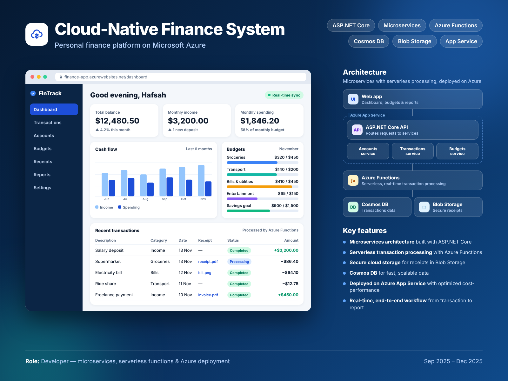
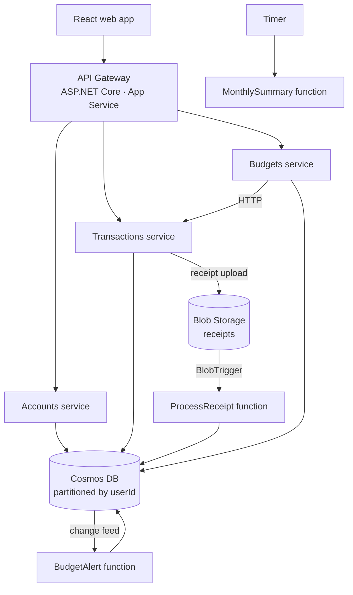
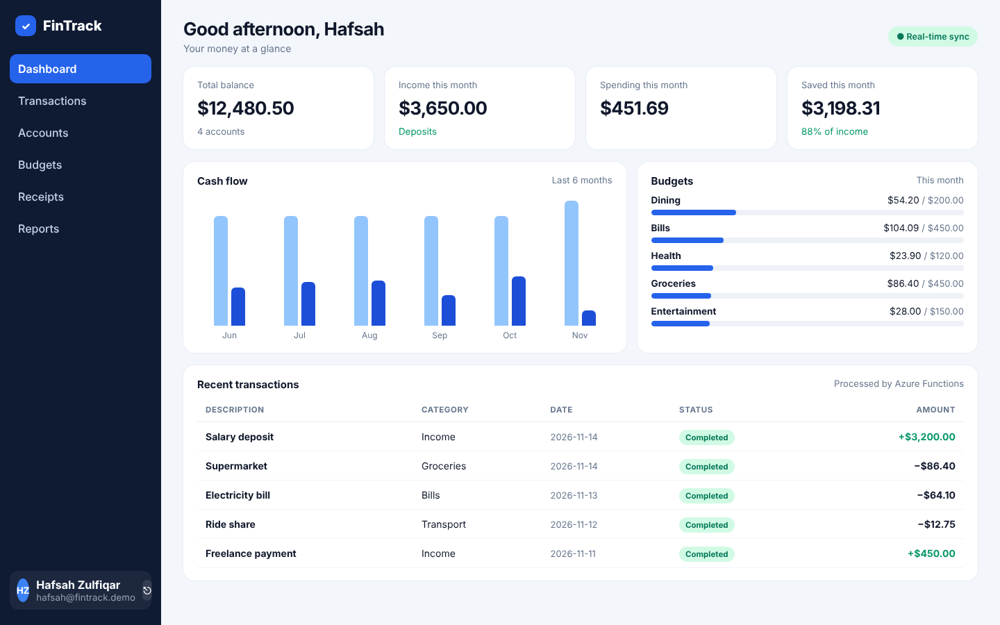
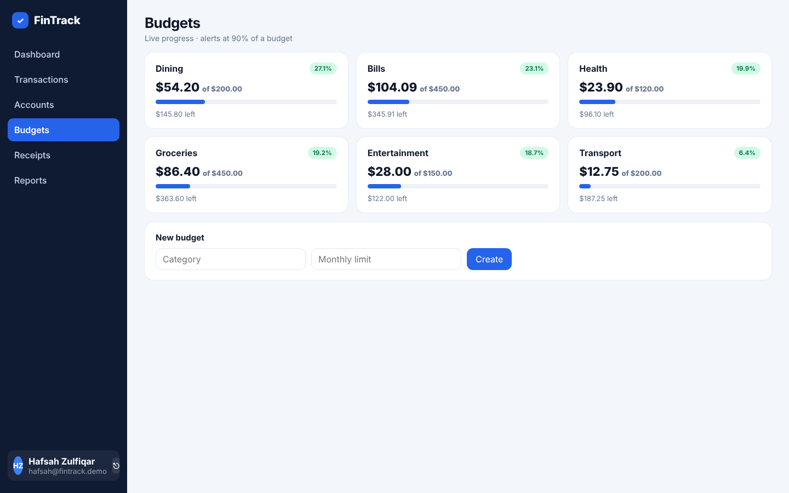
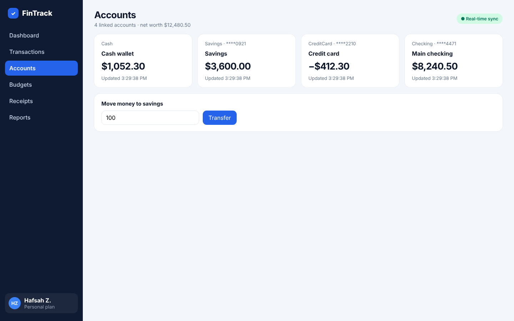

# Cloud-Native Personal Finance System

**FinTrack** — a personal finance platform built as **ASP.NET Core microservices** with **serverless Azure Functions**,
**Cosmos DB**, **Blob Storage** and a **React** web app, deployed on **Azure App Service**.



## Features

- **Dashboard** — total balance, monthly income and spending, 6-month cash flow, budgets and recent transactions
- **Transactions** — add, filter and search; uncategorised transactions are **auto-categorised** on arrival
- **Receipts** — uploads go to a private **Blob Storage** container; an **Azure Function** reads the total and matches it to the transaction
- **Budgets** — live progress per category; a **Cosmos DB change-feed function** raises an alert at 90% of a budget
- **Accounts** — linked accounts, net worth and transfers between accounts
- **Reports** — spending by category and monthly savings
- **Secure by default** — managed identities for Cosmos DB and Storage (no keys in config), HTTPS only, private blobs, per-user partitioning

## Architecture



| Component | Tech | Responsibility |
|---|---|---|
| `FinTrack.Gateway` | ASP.NET Core | Single entry point, routes `/api/*` to services, attaches the signed-in user, serves the web app |
| `FinTrack.Accounts` | ASP.NET Core minimal API | Accounts, balances, net worth, transfers |
| `FinTrack.Transactions` | ASP.NET Core minimal API | Transactions, auto-categorisation, receipt upload, cash-flow and category reports |
| `FinTrack.Budgets` | ASP.NET Core minimal API | Budgets and progress (calls the Transactions service), alerts |
| `FinTrack.Functions` | Azure Functions (isolated, .NET 8) | `ProcessReceipt` (Blob trigger), `BudgetAlert` (Cosmos DB trigger), `MonthlySummary` (Timer) |
| `FinTrack.Infrastructure` | Cosmos DB SDK, Azure Storage SDK | Cosmos repository and Blob receipt store |
| `FinTrack.Shared` | .NET class library | Models, categoriser, budget calculator, receipt parser, in-memory storage |
| `web/` | React, TypeScript, Vite | Dashboard, Transactions, Accounts, Budgets, Receipts, Reports |
| `infra/main.bicep` | Bicep | App Service, Functions, Cosmos DB (serverless), Storage, App Insights, role assignments |

## Screenshots

| Dashboard | Transactions |
|---|---|
|  |  |
| **Budgets** | **Receipts** |
|  |  |
| **Accounts** | **Reports** |
|  |  |

## Run locally

No Azure account needed: services use in-memory storage with sample data.

**Option 1 — Docker**
```bash
docker compose up --build
# open http://localhost:5100
```

**Option 2 — .NET + Node**
```bash
# terminal 1-4: one per service
dotnet run --project src/FinTrack.Accounts      --urls http://localhost:5101
dotnet run --project src/FinTrack.Transactions  --urls http://localhost:5102
dotnet run --project src/FinTrack.Budgets       --urls http://localhost:5103
dotnet run --project src/FinTrack.Gateway       --urls http://localhost:5100

# terminal 5: web app with hot reload
cd web && npm install && npm run dev            # http://localhost:5173
```

Run the tests with `dotnet test`.

## API

| Method | Route | Description |
|---|---|---|
| GET | `/api/accounts` | List accounts |
| GET | `/api/accounts/net-worth` | Total balance |
| POST | `/api/accounts/transfer` | Move money between accounts |
| GET | `/api/transactions?month=&category=&status=` | List and filter transactions |
| POST | `/api/transactions` | Add a transaction (auto-categorised if no category) |
| POST | `/api/transactions/{id}/receipt` | Upload a receipt (multipart) |
| GET | `/api/reports/cash-flow?months=6` | Income vs spending per month |
| GET | `/api/reports/categories?year=` | Spending share by category |
| GET | `/api/budgets?month=` | Budget progress |
| POST | `/api/budgets` | Create a budget |
| GET | `/api/budgets/alerts` | Alerts raised by the BudgetAlert function |

## Deploy to Azure

```bash
az group create -n fintrack-rg -l eastus
az deployment group create -g fintrack-rg -f infra/main.bicep -p prefix=fintrack
```

Or run the **Deploy to Azure** workflow from the Actions tab. It is manual only (pushes run CI, never a deploy) and needs the
repository secrets `AZURE_CLIENT_ID`, `AZURE_TENANT_ID`, `AZURE_SUBSCRIPTION_ID` (OIDC federated credential) and the variable `AZURE_RESOURCE_GROUP`.

Services switch to Cosmos DB and Blob Storage when `Storage__Provider=Azure` (set by the Bicep template).
For a dependency-free local build, use `dotnet build -p:UseAzure=false`.

## Author

**Hafsah Zulfiqar** — microservices, serverless functions and Azure deployment (Sep 2025 – Dec 2025)
