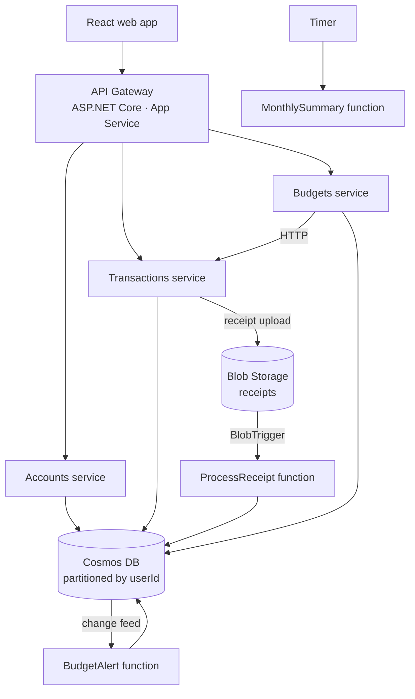
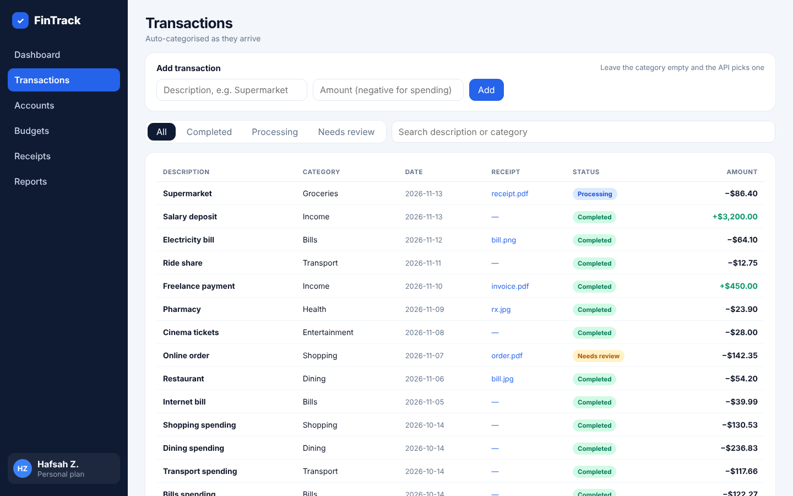
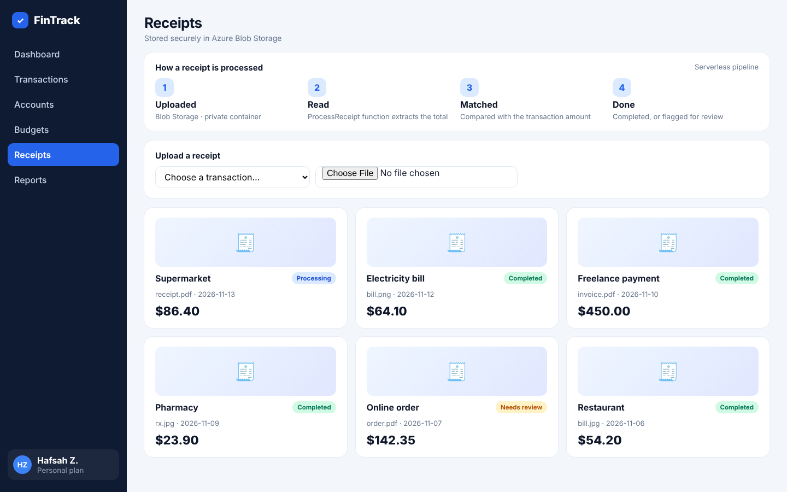
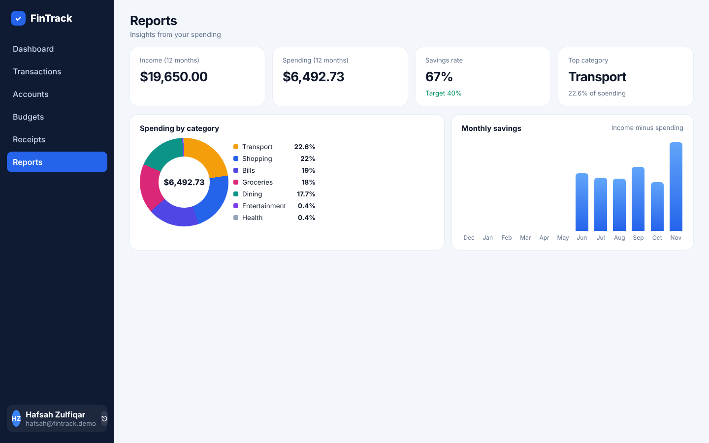
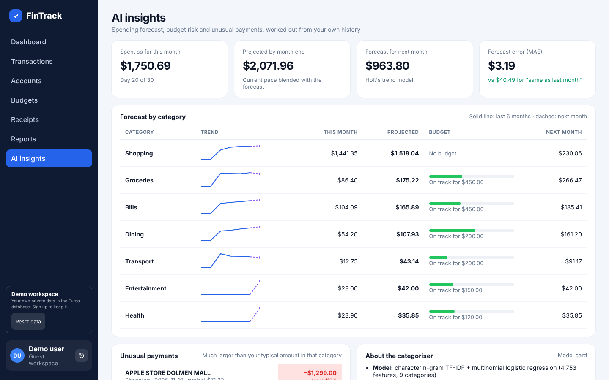

# Cloud-Native Personal Finance System

**FinTrack** — a personal finance platform built as **ASP.NET Core microservices** with **serverless Azure Functions**,
**Cosmos DB**, **Blob Storage** and a **React** web app, deployed on **Azure App Service**.


**Live site:** https://fintrack-two-rosy.vercel.app (create an account to start)

The live demo runs a **Node.js serverless API on Vercel backed by Turso (libSQL)** that exposes the same routes as the .NET gateway (`web/api/`):
JWT sign-in and sign-up (bcrypt); new accounts start with an empty workspace, and signing in returns you to the page you last had open; auto-categorisation, budget alerts, transfers with balance checks, receipt upload and processing, and reports.
The Azure/.NET build below is the main architecture; the Vercel API keeps the demo free to host.

## Features

- **AI categorisation** — a machine-learning model (character n-gram TF-IDF + logistic regression, trained in [`ml/`](ml/)) reads each bank-statement line and picks the category with a confidence score; 99.5% accurate on new lines from known merchants, 61% on merchants it has never seen (keyword rules: 34%). Correct a category once and FinTrack learns that merchant for you
- **AI insights** — next-month spending forecast per category (Holt's trend model tuned on your own history), month-end projection against each budget, and unusual-payment detection (robust z-score)

- **Dashboard** — total balance, monthly income and spending, 6-month cash flow, budgets and recent transactions
- **Transactions** — add, filter and search; uncategorised transactions are **auto-categorised** on arrival
- **Receipts** — uploads go to a private **Blob Storage** container; an **Azure Function** reads the total and matches it to the transaction
- **Budgets** — live progress per category; a **Cosmos DB change-feed function** raises an alert at 90% of a budget
- **Accounts** — linked accounts, net worth and transfers between accounts
- **Reports** — spending by category and monthly savings
- **Your own workspace** — a new account starts empty (add accounts, transactions and budgets yourself); "Clear my data" resets it, and signing in takes you back to the page you left
- **Secure by default** — managed identities for Cosmos DB and Storage (no keys in config), HTTPS only, private blobs, per-user partitioning

## Architecture



| Component | Tech | Responsibility |
|---|---|---|
| `FinTrack.Gateway` | ASP.NET Core | Single entry point, routes `/api/*` to services, attaches the signed-in user, serves the web app |
| `FinTrack.Accounts` | ASP.NET Core minimal API | Accounts, balances, net worth, transfers |
| `FinTrack.Transactions` | ASP.NET Core minimal API | Transactions, auto-categorisation, receipt upload, cash-flow and category reports |
| `FinTrack.Budgets` | ASP.NET Core minimal API | Budgets and progress (calls the Transactions service), alerts |
| `FinTrack.Functions` | Azure Functions (isolated, .NET 8) | `ProcessReceipt` (Blob trigger), `BudgetAlert` (Cosmos DB trigger), `MonthlySummary` (Timer) |
| `FinTrack.Infrastructure` | Cosmos DB SDK, Azure Storage SDK | Cosmos repository and Blob receipt store |
| `FinTrack.Shared` | .NET class library | Models, categoriser, budget calculator, receipt parser, in-memory storage |
| `web/` | React, TypeScript, Vite | Dashboard, Transactions, Accounts, Budgets, Receipts, Reports, AI insights |
| `web/api/` | Node.js (Vercel), Turso / libSQL | Live-demo API: same routes as the gateway, plus `ai/categorise` and `ai/insights` |
| `ml/` | Python, scikit-learn | Dataset, training, evaluation and export of the categoriser ([model card](ml/README.md)) |
| `infra/main.bicep` | Bicep | App Service, Functions, Cosmos DB (serverless), Storage, App Insights, role assignments |

## Screenshots

| Dashboard | Transactions |
|---|---|
|  |  |
| **Budgets** | **Receipts** |
|  |  |
| **Accounts** | **Reports** |
|  |  |
| **AI insights** | |
|  | |

## Run locally

No Azure account needed: services use in-memory storage with sample data.

**Option 1 — Docker**
```bash
docker compose up --build
# open http://localhost:5100
```

**Option 2 — .NET + Node**
```bash
# terminal 1-4: one per service
dotnet run --project src/FinTrack.Accounts      --urls http://localhost:5101
dotnet run --project src/FinTrack.Transactions  --urls http://localhost:5102
dotnet run --project src/FinTrack.Budgets       --urls http://localhost:5103
dotnet run --project src/FinTrack.Gateway       --urls http://localhost:5100

# terminal 5: web app with hot reload
cd web && npm install && npm run dev            # http://localhost:5173
```

Run the tests with `dotnet test`.

## API

| Method | Route | Description |
|---|---|---|
| GET | `/api/accounts` | List accounts |
| GET | `/api/accounts/net-worth` | Total balance |
| POST | `/api/accounts/transfer` | Move money between accounts |
| GET | `/api/transactions?month=&category=&status=` | List and filter transactions |
| POST | `/api/transactions` | Add a transaction (auto-categorised if no category) |
| POST | `/api/transactions/{id}/receipt` | Upload a receipt (multipart) |
| GET | `/api/reports/cash-flow?months=6` | Income vs spending per month |
| GET | `/api/reports/categories?year=` | Spending share by category |
| GET | `/api/budgets?month=` | Budget progress |
| POST | `/api/budgets` | Create a budget |
| GET | `/api/budgets/alerts` | Alerts raised by the BudgetAlert function |

## Deploy to Azure

```bash
az group create -n fintrack-rg -l eastus
az deployment group create -g fintrack-rg -f infra/main.bicep -p prefix=fintrack
```

Nothing deploys automatically: this repository has no deployment pipeline, only CI (build and tests).

### Cost

The Bicep template is locked to Azure's free tiers (no paid SKU can be selected), so a manual demo deployment costs nothing or close to it:

| Resource | Tier | Free allowance |
|---|---|---|
| App Service (4 services) | **F1 Free** | 60 CPU min/day per app, apps sleep when idle |
| Azure Functions | Consumption | 1M executions + 400,000 GB-s per month |
| Cosmos DB | **Free tier**, capped at 1000 RU/s | 1000 RU/s + 25 GB (one free account per subscription) |
| Log Analytics / App Insights | Daily cap 0.1 GB | 5 GB/month ingestion |
| Blob Storage | Standard LRS | a few cents at demo volume (free for 12 months on a new account) |

Pass `-p budgetAlertEmail=you@example.com` to get an email
as soon as the resource group spends anything. Delete the resource group when you are done: `az group delete -n fintrack-rg`.

Services switch to Cosmos DB and Blob Storage when `Storage__Provider=Azure` (set by the Bicep template).
For a dependency-free local build, use `dotnet build -p:UseAzure=false`.

## Author

**Hafsah Zulfiqar** — microservices, serverless functions and Azure deployment (Sep 2025 – Dec 2025)
